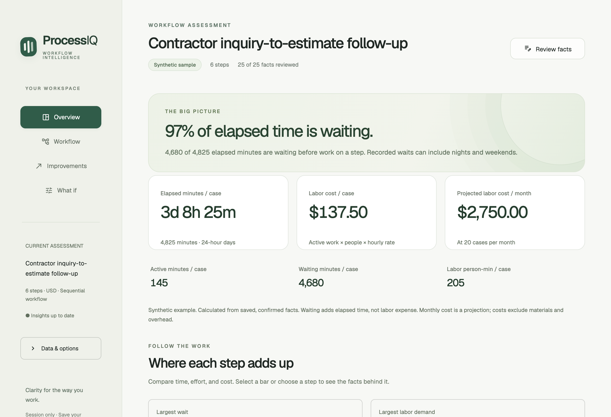
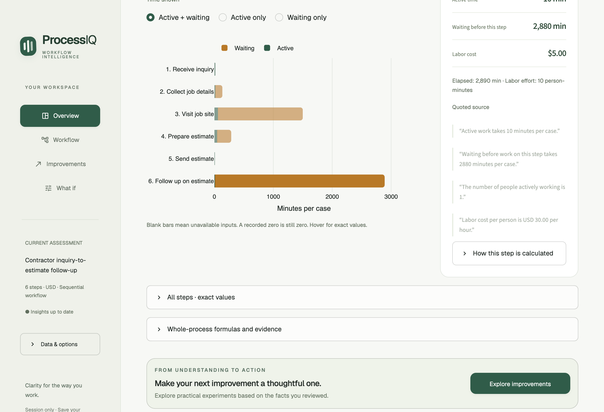
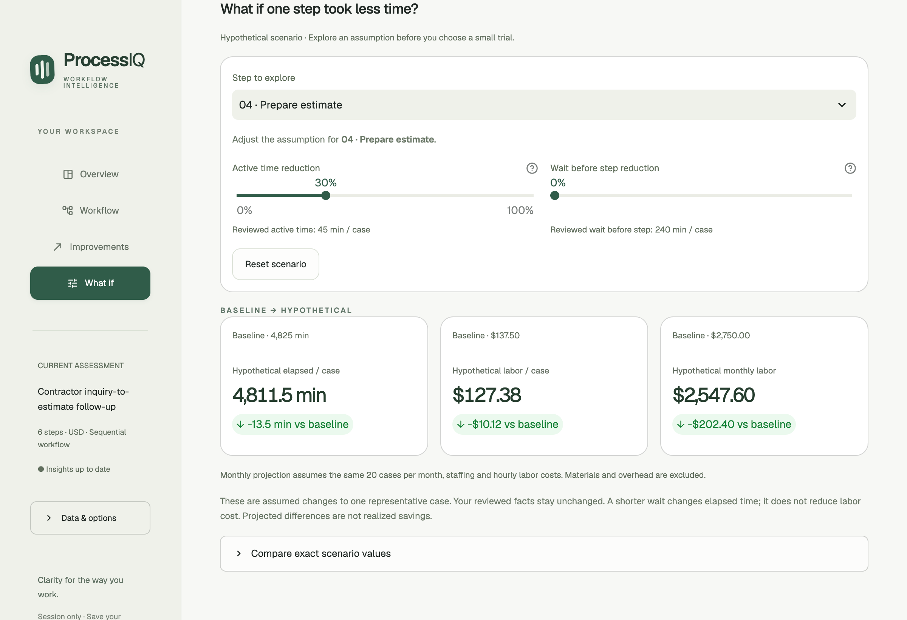

# ProcessIQ Week 1 Project Report

Faiza Aziz · Mastering Agentic AI · October 11, 2026

## Project overview

ProcessIQ helps a small service-business owner see where a repeatable workflow consumes time and labor. The finished local app turns reviewed workflow facts into an interactive dashboard, evidence-linked improvement actions, and hypothetical comparisons. It is prepared for Path C, the handout’s option to build an original app with any technology stack.

The example follows a contractor from a customer inquiry through estimate follow-up. An owner can upload a CSV, use a synthetic example, or describe a process through an optional AI interview. The owner reviews the facts before the app calculates results.

Figure 1. Actual application capture on October 11. The synthetic example has 4,825 elapsed minutes per case, $137.50 labor cost per case, and $2,750 projected monthly labor cost at 20 cases. Waiting accounts for about 97% of elapsed time. This describes the sample, not a measured customer outcome.

Code: https://github.com/faziz7-viz/ProcessIQ

Release: v0.2.0. The repository includes the application, sample data, tests, setup instructions, and design records. Access is currently private.

<!-- pagebreak -->

## Dataset and calculation choices

The project uses deliberately fictional workflow data, avoiding the need for customer records during a course demonstration. No advertising or stock dataset from the solution kit is used.

- data/contractor_estimate.json contains a complete six-step contractor workflow. All 25 numeric facts have source evidence and simulated owner confirmation.
- data/contractor_estimate_incomplete.json contains an incomplete version. It demonstrates unavailable totals and known subtotals without filling gaps with invented numbers.
- data/workflow_template.csv contains a three-step painting-quote example and provides an upload template. After review and confirmation, it produces $37.50 per case, $750 per month at 20 cases, and 105 elapsed minutes per case.

Each step records its name, responsible role, active minutes, waiting minutes before the step, people actively working, and hourly labor cost in USD. Monthly volume applies to the entire workflow. Numeric facts retain their source and confirmation status. Only step_name is mandatory in CSV input; missing numbers remain unknown.

CSV validation rejects unsupported or duplicate columns, invalid units and numeric values, and inconsistent workflow metadata. Imports accept UTF-8 files up to 2 MB and 200 steps. They do not silently convert weekly task frequency into monthly case volume.

### How the numbers are calculated

Elapsed time is the sum of active time and waiting before each step. Labor effort is active minutes multiplied by the number of people working. Labor cost is effort divided by 60 and multiplied by the hourly rate. Monthly labor cost is the sum of rounded step costs multiplied by confirmed monthly case volume. Python Decimal arithmetic controls money calculations and rounding.

For the complete sample, active time is 145 minutes, waiting is 4,680 minutes, and labor effort is 205 person-minutes. Waiting affects elapsed time but adds no labor charge. Elapsed days are 24-hour days; the data may include nights and weekends.

Unknown and unconfirmed values are excluded from complete totals. The incomplete demo shows an unavailable full labor cost alongside a $5 known subtotal. An explicit confirmed zero remains a valid zero.

### Technology and AI responsibilities

The app uses Python, Streamlit, pandas, Plotly, Pydantic, pytest, and an optional OpenAI integration. AI can ask follow-up questions and extract draft facts. All extracted numbers start unconfirmed. For improvement plans, AI selects from validated finding IDs and action templates; Python supplies displayed numbers and source quotes. CSV, sample data, calculation, scenarios, and offline plans work without an API key.

<!-- pagebreak -->

## How the project was built

The repository records six implementation milestones followed by the dashboard redesign. These are summaries of the saved plans and code, not a reconstructed transcript of earlier prompts.

1. Define the data contract. Validate units, source quotes, step IDs, and confirmation flags. Test complete and incomplete fixtures, invalid inputs, unknown values, and explicit zero.
2. Build deterministic analysis. Calculate time, effort, cost, and monthly projections from confirmed facts. Expose the formulas and contributing inputs.
3. Add review and a dashboard. Let the owner correct facts and confirm scope. Invalidate previous results when facts change.
4. Add the optional AI interview. Validate structured drafts, preserve source messages, and hand facts to owner review. Retain drafts when provider calls fail.
5. Add improvement plans. Select verified actions offline or with AI prioritization. Include evidence, suggested ownership, effort, and a measurement for each action.
6. Verify the complete journey. Test review, calculation, planning, corrections, and incomplete data. Add CSV input for existing workflow records.
7. Redesign for decisions. Preserve the engine while adding four workspaces, selectable chart views, source inspection, responsive navigation, and isolated scenarios.

Figure 2. A selected step exposes its figures and quoted inputs. Follow-up has 2,880 waiting minutes; this is a contribution to elapsed time, not proof of its cause. Captured from the final app rather than recreated as a mockup.

<!-- pagebreak -->

## Prompts and iteration evidence

Codex was used as the AI coding collaborator for planning, implementation, testing, browser inspection, and Git checkpoints. The following are actual excerpts from the retained conversation. Earlier milestone requests are documented by their saved plans, rather than presented as verbatim prompts.

“i have a project that woprkds end to end - i want to create a beautiful and interactive insights dashboard as the UI/ux for this project”

“suggest changes in the overall layout color typography motion graphics - premium feel- apple level aesthetics- act like a apple designer - plan it first”

The audience clarification was “Small-business owners making decisions”. That choice put a plain-language finding and the cost/time summary ahead of detailed tables.

“okay create a version control system and keep pushing to git and start working without any intervention- be proactive and show me the resulting app”

“now read the document for week 1 and wrap up this project accordingly”

The design was written before implementation. The redesign retained the calculation and evidence model, then added a restrained visual system: an ivory canvas, forest green navigation, amber waiting-time marks, local Geist and Instrument Serif fonts, clear spacing, rounded surfaces, and subtle motion with reduced-motion support.

### Concrete revisions after testing

The headline originally risked rounding a percentage twice. A regression test and direct Decimal formatting corrected the displayed result. Chart selection also required a browser check: the installed Plotly and Streamlit combination needed an explicit pan drag mode for clicks to reach the selection handler, with fixed axes preserving the view.

Responsive testing exposed a hidden sidebar reopen control after collapsing navigation. The CSS now preserves that control and constrains width only while the sidebar is expanded. Review edits and confirmation state were tested across workspace navigation.

### Version history

- 0841d98 preserves the working baseline, also tagged baseline-v0.1.0.
- e54800c records the design and implementation plan.
- 70d1ed8 adds the insights workspace and scenario explorer.
- a7fade9 adds responsive polish and release checks.
- c79a53a fixes sidebar access across responsive layouts; v0.2.0 identifies this app release.

The history and the saved plans in docs/ provide evidence of iteration. The attached solution kit was reviewed at wrap-up; its example prompts are not represented as prompts used to build ProcessIQ.

<!-- pagebreak -->

## Interactive decision support

The Overview starts with a finding computed from the reviewed data. Owners can compare elapsed time, labor effort, and labor cost, sort the steps, select a chart bar or use a keyboard-accessible step selector, and inspect the original evidence. Exact values and formulas remain available below the visual summary.

Workflow is the place to review and correct inputs. Improvements presents practical experiments with supporting evidence. What if explores a possible change without modifying the saved facts or making an AI request.

Figure 3. Reducing the 45-minute estimate-preparation step by 30%, with waiting unchanged, produces $127.38 per case and $2,547.60 per month under the app’s rounding policy. The $202.40 monthly difference is hypothetical; the reviewed baseline stays $137.50 per case and $2,750 per month.

This distinction matters for an owner deciding what to test. A shorter assumed wait affects turnaround time but does not automatically reduce labor expense. A suggested action is an experiment whose outcome must be measured.

The interface makes this separation visible: real input corrections happen in Workflow, while hypothetical reductions live in What if. Unsaved corrections clear previous results and require saving and recalculation.

<!-- pagebreak -->

## Verification and lessons learned

The final offline suite passes 345 tests with warnings treated as errors. Three opt-in live-provider tests are skipped. Tests cover input validation, exact arithmetic, CSV handling, source grounding, review state, provider failure handling, recommendations, chart selection, and scenario isolation. GitHub Actions runs the offline suite on pushes and pull requests.

Browser verification covered complete and incomplete examples, chart selection and evidence updates, offline plans, correction and recalculation, the 30% scenario, and a narrow viewport. The screenshots in this report are actual captures from the local app on October 11, 2026. The saved milestone records document earlier live synthetic smoke tests; the final verification did not repeat live API calls.

### What worked and what needed care

A precise data model made AI assistance easier to check. Explicit units, source quotes, and confirmation flags gave both tests and the interface a clear contract. The complete fixture pinned expected results; the incomplete fixture exposed misleading assumptions that a polished dashboard could otherwise hide.

Small implementation stages made failures easier to isolate. Automated tests established arithmetic and state behavior, while browser inspection found interaction and responsive defects that those tests alone missed. Preserving the working baseline in Git made the redesign reviewable and reversible.

The most useful visual changes reduced the number of decisions on each screen. A business owner can read the summary, inspect one step, and choose an experiment without first interpreting a large raw table. Visual polish remains useful only when uncertainty, units, and evidence stay visible.

### Limits and next steps

ProcessIQ currently assesses one sequential representative workflow in USD. It uses owner estimates and temporary session data. Costs exclude materials and overhead; monthly figures are projections. Evidence establishes traceability, not whether an estimate is true. The app does not model parallel work, prove bottleneck causes, or establish realized savings.

This release is a local course demonstration. Persistent storage, account access, integrations, production deployment, and measured before-and-after outcomes remain future work. Refreshing or restarting can lose session data, so source files should be retained.

### Course references and reproduction

Requirements were checked against the supplied Week 1 Project Handout (Oct 2026).pdf. ProcessIQ follows Path C. The supplied Oct Week 1 Ad Campaign Performance Analyzer Solution Kit.pdf was consulted as an example of documenting prompts, fixes, and tests; its app-specific requirements and deployment instructions are not ProcessIQ requirements.

To reproduce, clone the repository, run uv sync --locked, then uv run streamlit run app.py --server.address 127.0.0.1. Open http://127.0.0.1:8501/?demo=complete in a new session. The repository’s docs/demo-guide.md contains the current walkthrough and expected results. The course also requires a separate video of at most five minutes and submission of the document, video, and GitHub links.
